# LLTS

Low-latency laser tracking of a ping pong ball. Two synchronised global-shutter cameras find the ball, stereo triangulation gives its 3D position, and an XY galvo steers a laser onto where the ball will be when the mirrors get there.

**Status:** work in progress, actively developed. The parts below run and are measured; we are now joining them into one closed loop.

<p align="center">
  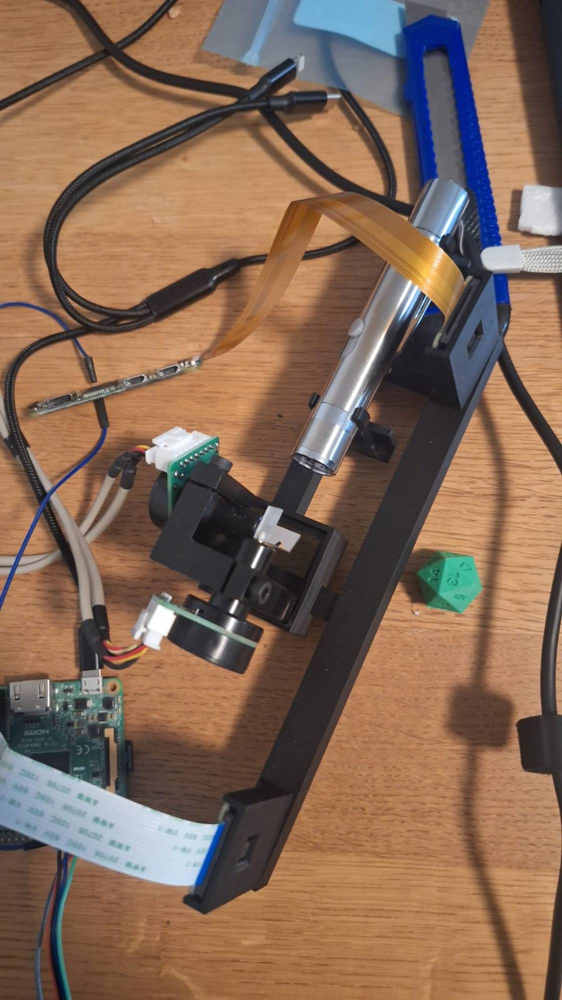
  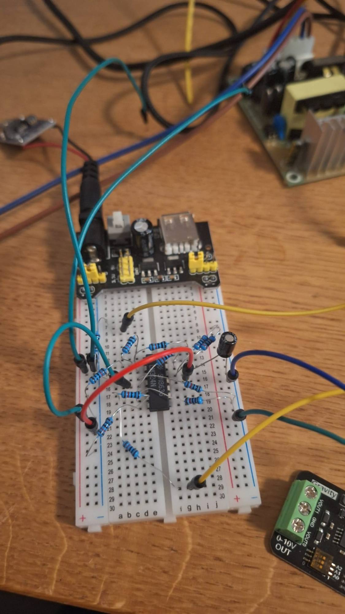
</p>
<p align="center"><sub>The printed head: cameras at both ends, XY galvo in the middle, laser in two sliding clips. Right: DAC and op-amp stage driving the galvo.</sub></p>

## Hardware

| | |
|---|---|
| Cameras | 2 × OV9281, 1280×800 mono, global shutter, 2.85 mm f/2 |
| Compute | Raspberry Pi 3B (camera A, main loop) and Raspberry Pi Zero W (camera B) |
| Beam | XY galvo with drivers, laser module |
| Galvo drive | GP8403 2-channel I2C DAC, LM324 stage mapping 0–10 V to ±5 V, separate 5 V reference |
| Sync | 10 Hz hardware PWM from the Pi 3B to both Pis, one wire |
| Mount | parametric OpenSCAD, 3D-printed, press-fit, no screws |

## Architecture

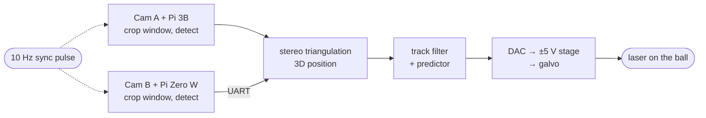

- **Small window, high frame rate.** The predictor moves a crop window on each sensor (over I2C, while streaming), so only the rows around the ball are read. That takes the OV9281 from 138 fps to 679 fps (128 rows) or over 1000 fps (64 rows).
- **One timebase.** Both sensors are phase-locked to the same pulse, so frame *n* on both cameras is the same instant, which is what makes the triangulation valid for a fast ball.
- **Detection next to the sensor.** Each Pi detects in its own image and sends only coordinates. Detection is algorithmic today (threshold against a learned empty-scene map, blob fill, centroid, search window around the prediction). Once detection moves onto an FPGA that reads the sensor directly, it may be replaced by a small neural net.
- **Aim ahead.** The predictor leads by the latency of the whole chain.

Details: [system architecture](docs/system-architecture.md).

## Results

### Tracking

<p align="center">
  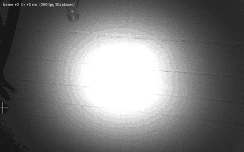
  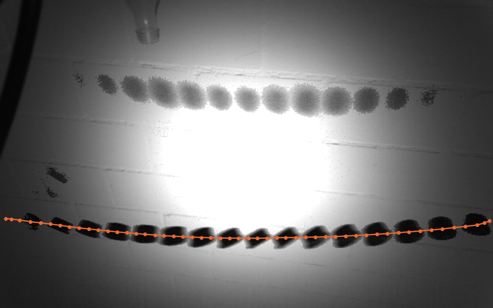
</p>

A throw at 250 fps, replayed through the current [`track.c`](tools/track/track.c). The object is found in all 51 frames it is in view, and the tracker ignores its shadow. In a 1000-frame hand-held recording it holds the object in 999 frames.

### Frame rate and latency

<p align="center">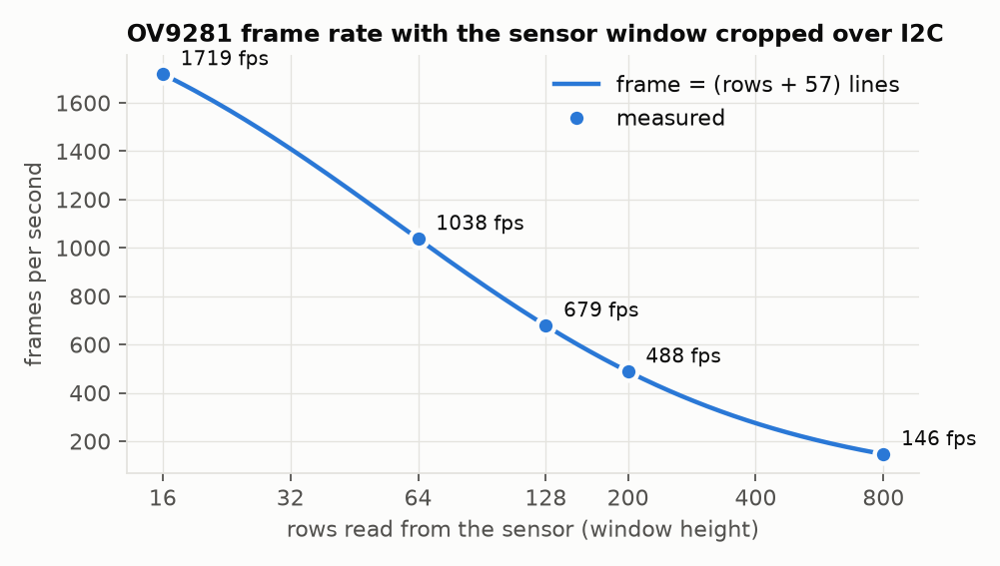</p>
<p align="center">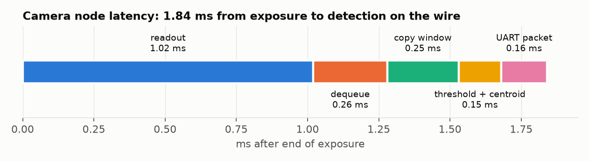</p>

Measured on the Pi 3B: pixel-exact windows, 0 dropped frames in 4000 down to 64 rows, and a moved window lands exactly two frames later every time. [Report](docs/test-reports/crop-evaluation.md)

### Camera sync

<p align="center">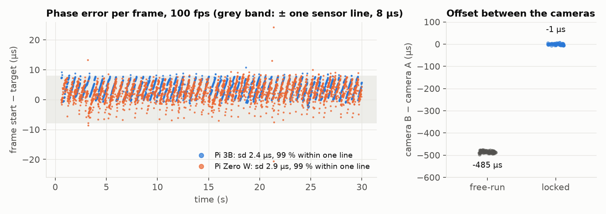</p>

Free-running, the two cameras were half a millisecond apart. Locked, they sit within one sensor line (8 µs) of each other, with no dropped frames. On a randomly flashing screen, 60 of 61 flashes landed in the same frame on both cameras. [Report](docs/test-reports/frame-sync-2026-11-03.md)

### Calibration

<p align="center">
  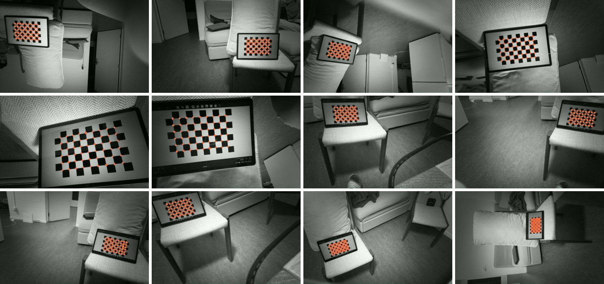
  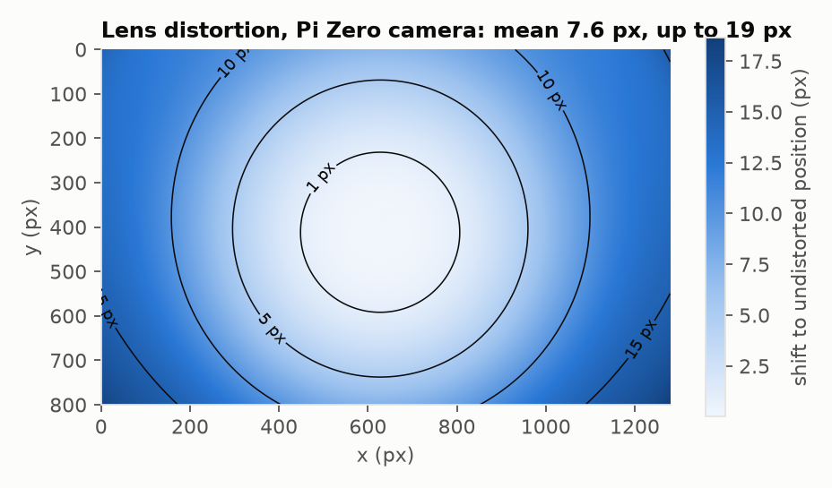
</p>

Automatic capture from a tablet checkerboard, 60 views, 0.148 px reprojection error. Measured field of view 66.7° × 44.8°. [Report](docs/test-reports/test-results-2026-11-02.md)

### Beam and mount

The DAC scripts already draw circles, squares and text with the galvo, with hard voltage caps and slew limits to protect the mirrors ([`tools/dac/`](tools/dac/), [analog stage](docs/galvo-analog-stage.md)). The head is modelled with the camera fields of view and the ±30° scan cone, so none of them touch the frame ([CAD](cad/head-mount/README.md)).

<p align="center">
  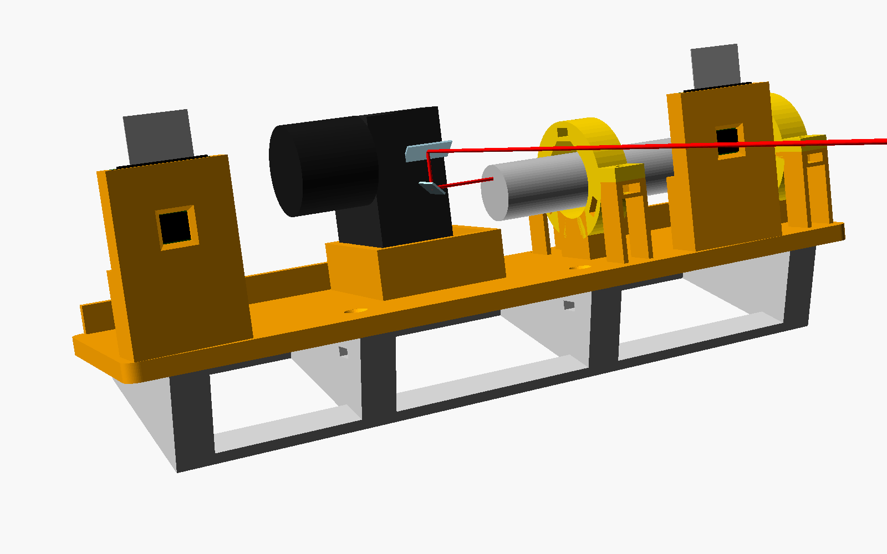
  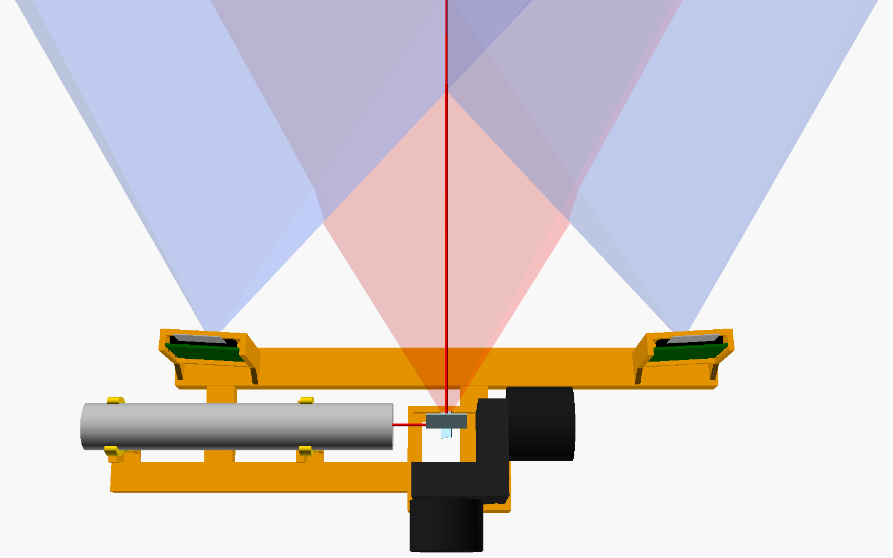
</p>

## Repo layout

```
docs/          architecture, analog stage, setup notes, test reports, figures (make_figures.py)
tools/crop     sensor window over I2C        tools/sync    camera frame sync, flash test
tools/calib    live view and calibration     tools/track   tracker and recording viewer
tools/dac      DAC driver, galvo patterns    cad/          head mount (OpenSCAD, STL, 3MF)
calib/         calibration data per camera
```

Some setup notes are in German; the reports are in English.

## Team

First-semester students at ETH Zurich: Tom Schmidt-Ott (Electrical Engineering and Information Technology), Tim Sindelar (Computer Science), Hannes Sobottka (Physics).

## License

[MIT](LICENSE)
