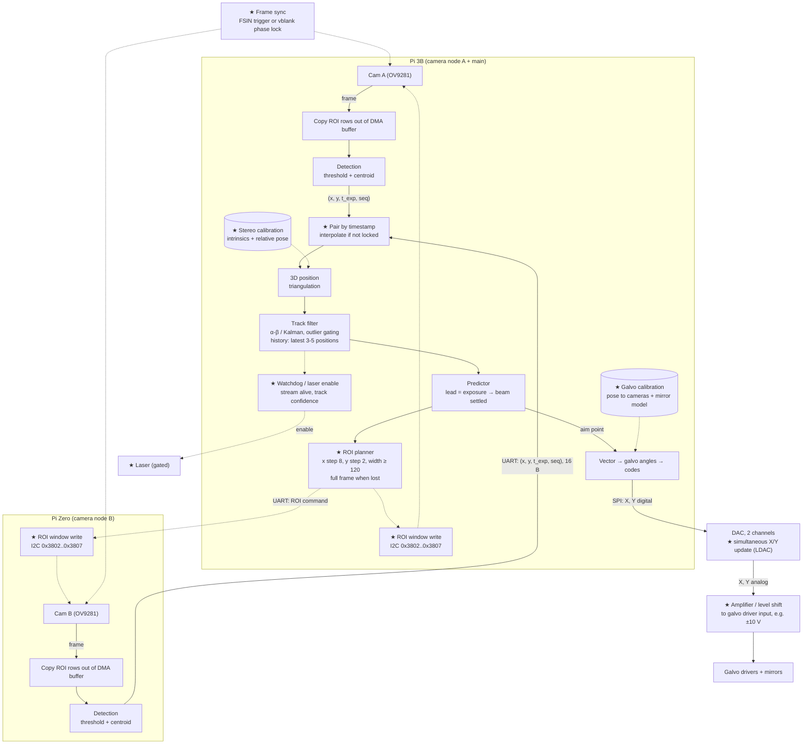

# System architecture: block diagram, 2026-11-02
pizero:
tom@192.168.1.48
Pi 3 B:
tom@192.168.1.94
password for both is "1234".

The first sketch is in `block_diagram.jpg`. This doc types it out and adds the blocks it was missing. The numbers come from `crop-evaluation.md` and `test-results-2026-10-29.md`.

## As drawn
```
┌─ Pi Zero ───────────┐   ┌─ (unlabelled box, presumably the Pi 3B) ────────────────────┐
│ Cam                 │   │ Cam                                                         │
│  │ frame            │   │  │ frame                                                    │
│  ▼                  │   │  ▼                                                          │
│ [Detection]         │   │ [Detection]                                                 │
│  │ (x, y, frame_id) │   │  │ (x, y, frame_id)                                         │
│  │                  │   │  ▼                                                          │
│  └──────────────────┼───┼─►[3D position] ──store──► [latest 3-5 positions]            │
└─────────────────────┘   │    │                          │                             │
                          │    │ current                  │ latest frames               │
                          │    ▼                          ▼                             │
                          │    └───────► [Predictor] ◄────┘                             │
                          │                  │ vector                                   │
                          │                  ▼                                          │
                          │      [Vector → Galvo voltage]                               │
                          └──────────────┬───────────┬──────────────────────────────────┘
                                X digital│           │Y digital
                                         ▼           ▼
                                       [        DAC        ]
                                X analog │           │ Y analog
                                         ▼           ▼
                                       [       Galvo       ]
```

## Revised
Added blocks are marked with ★. Dashed arrows are feedback or control paths, not the main data flow.



## What changed and why
1. **Frame sync between the two cameras.** `frame_id` was the V4L2 `seq` of each camera, and the two counters don't refer to the same moment. Two free-running sensors drift against each other, and a 1 ms offset at 5 m/s puts the two views ~5 mm apart in time, which goes straight into the 3D position.
   - Lock the sensors with FSIN or the planned vblank phase lock (tests 9-10), **and** send the exposure time `t_exp` in a shared timebase.
   - `PAIR` matches detections by `t_exp`. If the cameras aren't locked yet, it interpolates one view to the other's time.
   - V4L2 timestamps mark frame start, so t_exp = ts + (ROI start row + exposure / 2) · 7.967 µs, roughly.
2. **ROI feedback to both cameras.** The 678+ fps from the crop evaluation only holds if the window follows the target every frame.
   - `PLAN` turns the prediction into a window that obeys `roi.py`'s rules and sends it to Cam A over I2C and to the Pi Zero over a UART return channel.
   - A window move shows at frame k+2, so the planner must look 2 frames ahead plus prediction error (see "Sizing the ROI" in `crop-evaluation.md`).
   - When the target is lost, it falls back to a full or large window to find it again.
3. **Calibration as explicit inputs.** Triangulation needs the stereo calibration. The galvo mapping needs the galvo's pose relative to the cameras and a model of the two-mirror geometry, which is not linear in angle.
4. **Analog stage.** A typical SPI DAC outputs 0 to Vref, while galvo drivers usually want ±10 V, often differential, so an amplifier stage sits between them. The DAC should latch X and Y together, so the beam doesn't move diagonally between the two updates.
5. **Watchdog / laser enable.** It switches the laser off when a camera stream stalls, the track is lost or the filter's confidence drops.
6. **Track filter instead of a raw position list.**
   - Fit on timestamps, not frame indices, because 16-row windows drop frames.
   - Gate outliers before they reach the predictor.
   - The separate "current" arrow is gone, since the history already holds the current position.
7. **The predictor's lead time covers the whole chain:** exposure → packet (~1.85 ms at 128 rows) + UART + compute + DAC + galvo settling.

## Open points
- **Pi Zero performance is untested** (test 8). Benchmark capture + ROI copy + centroid at the target fps before committing to the split. `PAIR` waits for the slower of the two paths.
- The galvo, DAC and amplifier are not chosen yet. Their step response and settling time set part of the predictor's lead time.
- The FSIN trigger vs. vblank phase lock choice is open. FSIN needs a wire to both sensors and support in the driver.
