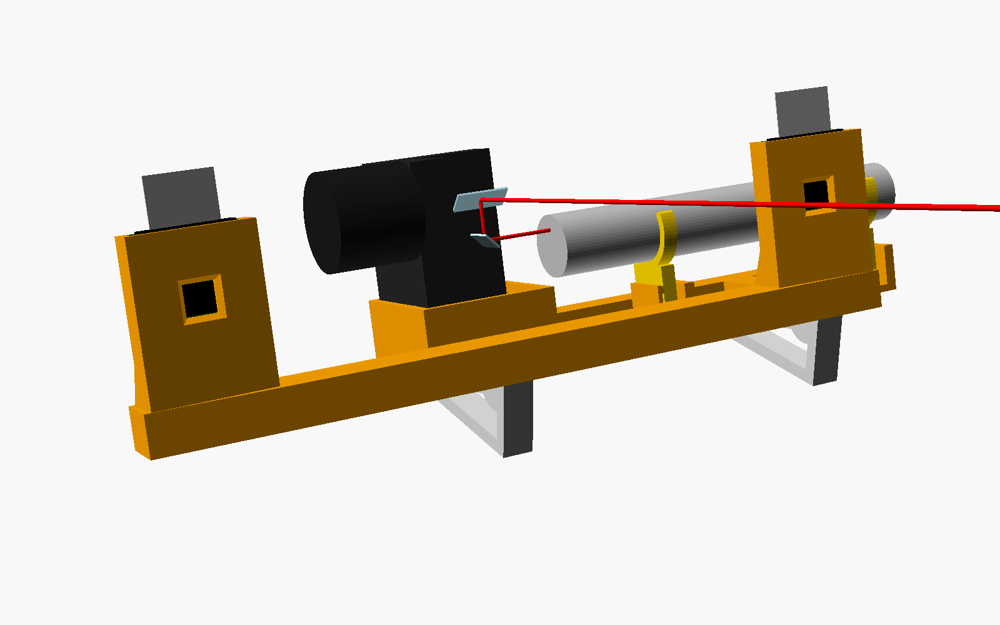
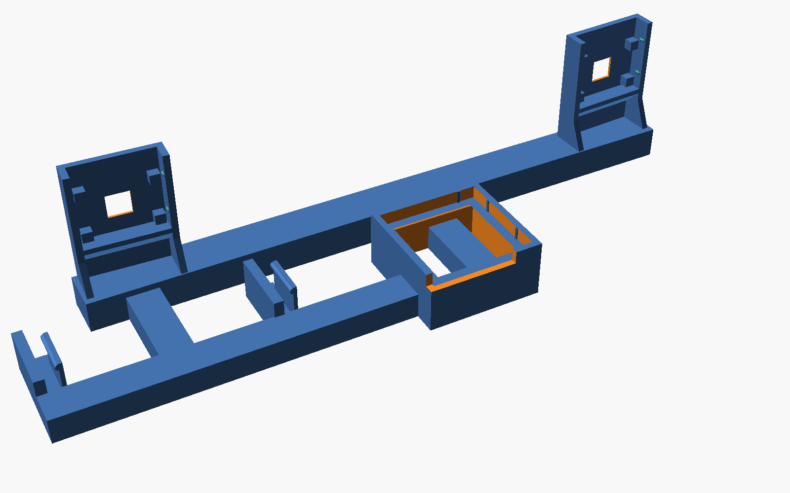
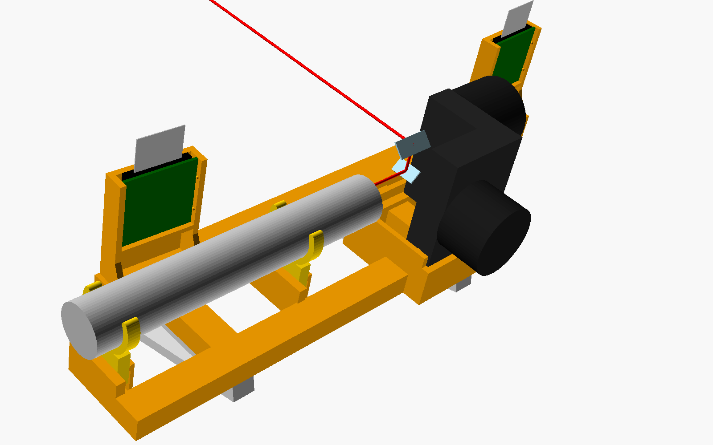
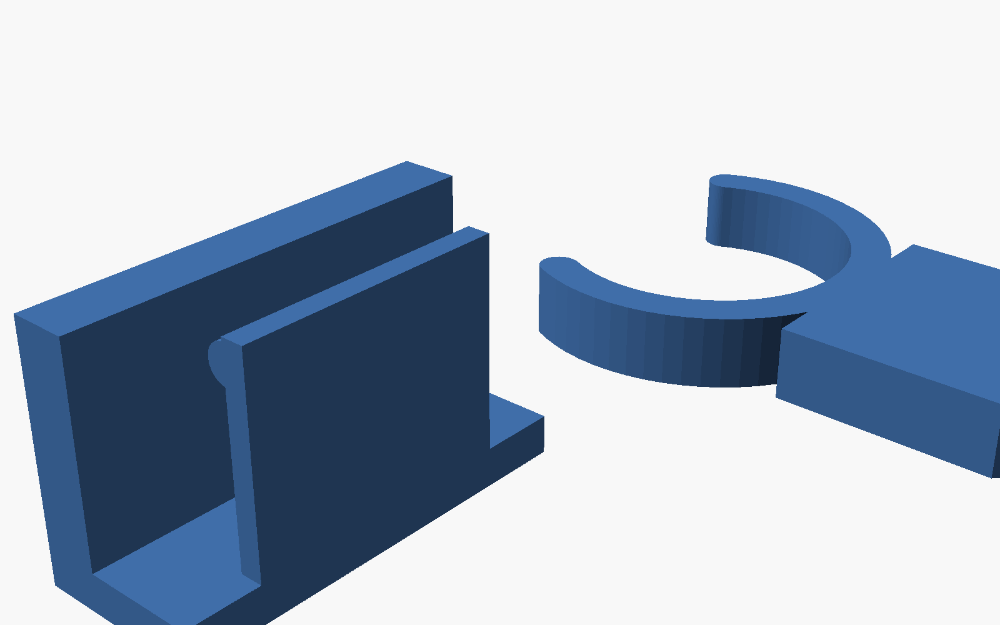
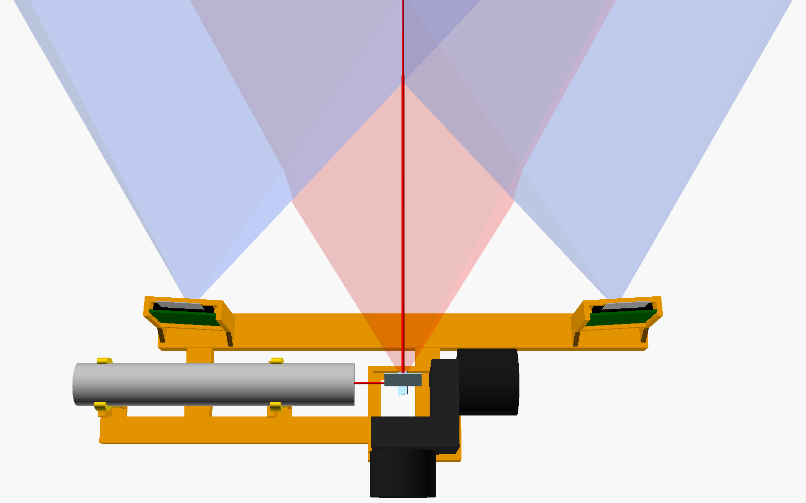

# Head mount: cameras, galvo, laser (2026-11-17)
A 3D-printed mount that holds both OV9281 cameras, the XY galvo and the laser, plus two feet that tilt the whole head up.
- **No screws:** cameras and galvo press in, the laser snaps into two clips, and the feet plug in with pegs.
- **Little material:** the head is a frame of rails rather than a plate, and the galvo seat is hollow. The feet are solid 8 mm wedges; the slicer's sparse infill keeps them light.
- **Parametric:** everything is in one OpenSCAD file, [llts_head.scad](llts_head.scad). Open it in OpenSCAD and change values under Window > Customizer.

| Assembly | Head only |
|---|---|
|  |  |
|  |  |



## Geometry
| | Value | Parameter |
|---|---|---|
| Camera spacing (lens to lens) | 165 mm | `cam_spacing` |
| Toe-in per camera | 3.3° (designed for a 60° galvo) | `toe_in` |
| Upward pitch of the whole head | 15°, set by the feet | `pitch` |
| Galvo | centred between the cameras, beam leaves along the head's forward axis | |
| Laser | enters from the left, horizontally, at the lower mirror's height | |
| Beam height above the head's underside | 31.5 mm (galvo floor 14 + mirror 17.5) | `galvo_floor`, `mirror_h` |
| Camera lens height above the head's underside | 32 mm | `cam_lens_z` |
| Head footprint | 220 × 59 mm | derived |

- **Cameras sit 30 mm in front of the galvo exit.** So they don't see the galvo or the laser, and the beam never reaches the camera holders.
- **The laser runs behind the left camera.** The checks render the head against the camera fields of view, the galvo scan cone (±30°) and the laser path; all three come out empty. The only overlaps are the intended press fits.
- **Galvo orientation**, seen from behind the head looking where the beam goes: the X motor (lower mirror) sticks out backward and the Y motor (upper mirror) to the right. The lower mirror scans horizontally.

## How each part is held
- **Cameras.** Pushed in from behind, connector up, against four small posts at the mounting holes. Crush ribs on the side walls hold the board. The lens ends flush with the front face.
- **Galvo.** Rests on a 3 mm ledge along the walls of a hollow box. A 4 mm lip with crush ribs runs closed around all four sides and locates it. The X motor clears the lip by about 1 mm.
- **Laser.** Snaps into two C-clips on the clear sections of the tube (30 mm and 97 mm from the front). Each clip sits on a blade, and the blade slides in a socket where a printed leaf spring presses it against a rigid wall.
  - **Adjustment:** friction holds the blade anywhere within ±3 mm up/down and forward/back.
  - **Two clips:** height, side shift and tilt of the beam.
- **Feet.** Two solid wedges under the two spines of the frame. Each has two pegs that press into holes with crush ribs.

## Parts
| File | Contains |
|---|---|
| `head_mount_plate.3mf` | head, foot_left, foot_right, 2 × slider, placed on a 256 × 256 plate |
| `test_plate.3mf` | test_galvo (camera and socket test pieces are in `stl/`) |
| `stl/*.stl` | the same parts as single STLs |

| Part | Count | Print orientation (already set in the files) |
|---|---|---|
| head | 1 | flat, frame on the bed |
| slider | 2 | flat, clip lies on the bed |
| foot_left, foot_right | 1 each | standing, pegs up |

- **Material:** about 65 cm³ of outer volume in total, so with normal infill roughly 40-50 g of filament.
- **Print settings:**
  - Head and feet: 0.2 mm layers, 3 walls, 15-20 % gyroid infill. The rails get most of their stiffness from the walls.
  - Sliders: PETG if you have it, since the clips have to spread about 2 mm to snap onto the tube. 100 % infill, they are only 4 mm thick.
  - No supports needed anywhere. Every overhang is 45° or steeper, except the 5 mm tops of the peg holes (short bridges) and the camera posts, which stick out 3 mm from the front wall.
- **Bed size:** the head is 220 mm long. It fits a 256 mm bed. On a 220 × 220 bed, turn it 45°.

## Before printing the head
1. **Lower mirror position.**
   - **Measured:** the mirror centre is 15 mm in front of the bracket face where the X motor shaft comes out (`mirror_from_col`). Together with the 17.5 mm height, this sets where the laser aims.
   - **Estimated:** the bracket part the X motor is clamped in is about 11 mm thick, from the back face to that shaft exit (`galvo_col_t`). If you can measure it, set it; the sliders absorb ±3 mm either way.
   - **Not critical:** `mirror_x` (11.5 mm from the bracket's left face) only changes how far the laser sits from the galvo, not where it points.
2. **Galvo footprint.** The seat expects the L-shaped bracket to fill a 33 × 33 mm box, so the pocket is 33.5 mm inside with clearance (32 measured from photos, set to 33 after the test print) (`galvo_w`, `galvo_d`) and to rest on its outer edges. The X motor must sit at least 4 mm above the bracket bottom, because the lip is closed on all sides. Otherwise lower `lip_h`.
3. **Laser hole.** Rotate the laser so the beam hole points up. The clips are placed for that. If it has to point elsewhere, set `laser_hole_angle` (90 = up, 270 = down).
4. **Print the test pieces** (~30 min in total) and adjust in steps of 0.05 mm:
   - `test_camera`: the PCB should press in by hand and stay put. Too tight: lower `pcb_rib_interf`; too loose: raise it.
   - `test_galvo`: the galvo should press in with light force. Tune `galvo_rib_interf` and `galvo_clear`.
   - `test_socket`: the slider should slide with a firm push and stay where it is left. Too loose: raise `preload`; too stiff: lower it or thin `leaf_t`. The laser should snap into the clip and not turn by hand; tune `clip_interf` and `clip_open`.

## Assembly
1. **Feet:** press both onto the head's underside: left foot under the left spine, right foot under the galvo seat.
2. **Cameras:** push each in from behind, connector up, until the board sits on the four posts. The ribbon leaves upward and bends back over the laser.
   - **The image is upside down** compared with the connector-down orientation. The intrinsic calibration stays valid, because it belongs to the sensor. Do the stereo calibration after mounting.
3. **Galvo:** press it into its seat, X motor toward the back.
4. **Laser:** snap the tube into both sliders in your hand, hole up, clips on the clear sections. Then push both blades down into their sockets.

## Aligning the laser
Use the lowest laser power and laser safety glasses. Centre the galvo (0 V on both axes) and put a scrap of paper on the lower mirror to see the spot.
1. **Move the beam:** push the sliders up/down or forward/back. Both sliders the same way shift the beam in parallel.
2. **Tilt it:** move only the back slider. The beam tilts around the front clip, and the spot moves about 0.7 mm the opposite way per 1 mm.
3. **Leave it:** once the spot sits on the mirror centre, friction holds it. For a permanent fix, add a drop of glue between blade and socket.
4. **Rotation:** don't turn the tube in the clips. The hole sits 4.25 mm off the tube axis, so turning it moves the beam.

## Slicing in Bambu Studio
1. **Test plate first.**
   - **Open:** in Bambu Studio, File > Open Project, then `test_plate.3mf`. If it asks whether to load geometry only, confirm; the file comes from OpenSCAD, not Bambu Studio.
   - **Printer and filament:** pick yours, use the 0.20 mm Standard process, leave supports off, slice and print.
   - **If a fit is off:** change the parameter (see "Before printing the head") and run `./build.sh` again.
2. **Main plate.** Open `head_mount_plate.3mf`. You get five separate objects: head, foot_left, foot_right and two sliders, already lying in print orientation.
   - **Orientation:** don't use Auto-orient; it may flip the head onto its side.
   - **Arrange:** on a 256 mm bed (A1, P1, X1) everything fits as placed. On another bed press A (Arrange). The head needs 220 mm, so it doesn't fit an A1 mini.
3. **Global settings:** 3 wall loops, 15-20 % sparse infill (gyroid), no supports.
4. **Per-object settings,** in the object list on the left (Objects tab): right-click an object > Add settings.
   - **slider:** Strength > sparse infill density 100 %.
   - **foot_left, foot_right:** Others > brim type "Outer brim only", 3 mm wide. They are thin and stand upright.
5. **Filament.**
   - **All in PETG:** simplest, one plate, nothing to change.
   - **PLA for head and feet:** move the two sliders to a second plate and print them in PETG. Right-click > Move to plate, or delete them and import `stl/slider.stl` on a new plate.
6. **Preview check:** slice and look at the preview. There should be no support anywhere, and the head's frame should be fully on the first layer.

**Importing the STLs yourself instead.**
1. File > Import > Import 3MF/STL/STEP and select `head.stl`, `slider.stl`, `foot_left.stl` and `foot_right.stl` together.
2. When Bambu Studio asks whether to load them as a single object with multiple parts, answer **No**, so each stays its own object.
3. Right-click the slider, choose Set number of instances, and enter 2.
4. Press A to arrange.

## Regenerating the files
```bash
cd cad/head-mount && ./build.sh
```
- **What it does:** renders every part to `stl/` with OpenSCAD, then `make_3mf.py` packs them into the two 3MF plates.
- **OpenSCAD:** installed with `brew install --cask openscad@snapshot`; the stable cask is disabled in Homebrew.
- **Console output:** head size, beam height, clip positions, the gap between the laser and the left camera, and the socket and leaf dimensions.

## Open points
- **Galvo bracket thickness** (`galvo_col_t`): estimated at 11 mm. The sliders cover ±3 mm.
- **Pi boards and cable strain relief:** not part of the mount yet. Keep the camera ribbons from pulling on the cameras, since that would move them after calibration.
